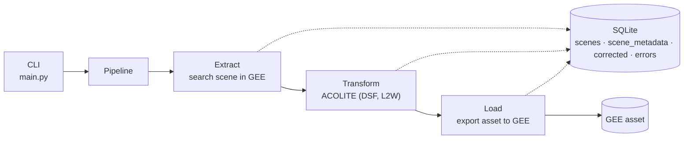

# Sentinel-2 Atmospheric Correction with ACOLITE

[](LICENSE)


An idempotent ETL pipeline that atmospherically corrects Sentinel-2 L1C scenes with
[ACOLITE](https://github.com/acolite/acolite) through Google Earth Engine (GEE), exports the
water-quality and bathymetry products as GEE assets, and tracks every run in a SQLite database.

## Overview

Coastal and inland water products (reflectance, turbidity, chlorophyll, shallow-water bathymetry)
require a dedicated atmospheric correction. This project automates that correction at scale:

- One run processes one scene, defined by a **date**, a **tile** and a **region of interest (ROI)**.
- Results are stored as Earth Engine assets, so no imagery is downloaded locally.
- The state of every scene and correction is recorded, which makes the pipeline **safe to re-run**
  and suitable for unattended batch processing of whole years.

### Output products

Each corrected scene is exported at 10 m resolution (EPSG:4326), clipped to the ROI, with these bands:

| Product | Bands |
| --- | --- |
| Remote-sensing reflectance | `Rrs_B1` … `Rrs_B7` |
| Turbidity | `TUR_Nechad2016_665` |
| Chlorophyll-a | `chl_oc3` |
| Pseudo-satellite-derived bathymetry | `pSDB_green`, `pSDB_red` |

## Architecture



| Stage | Responsibility |
| --- | --- |
| **Extract** | Searches the tile for the requested date inside the ROI. If several products exist, the most recently generated one is used. A date with no image is recorded as such. |
| **Transform** | Runs ACOLITE (dark spectrum fusion, L2W water products) from a local ACOLITE installation. |
| **Load** | Selects the output bands and starts an `Export.image.toAsset` task. The pipeline polls it until completion (30 min timeout) and cancels it on timeout or interruption. |

The steps are injected into the `Pipeline` as callables, so the whole orchestration is testable
without Earth Engine, ACOLITE or network access.

### Idempotency

A correction is uniquely identified by:

```
(scene, ACOLITE version, ACOLITE settings hash, ROI hash)
```

- Re-running an already corrected target finishes in seconds without calling Earth Engine.
- Changing the ROI, the ACOLITE version or the ACOLITE settings produces a **new** correction.
  Credentials and the local ACOLITE path are excluded from the settings hash.
- Failed targets are retried on the next run.
- Asset ids are deterministic (`{date}_{tile}_{settingsHash}_{roiHash}_L2W`). If a previous run lost
  its state after exporting, the next run finds the existing asset and adopts it instead of
  exporting it again.

### State database

| Table | Purpose |
| --- | --- |
| `scenes` | One row per searched `(date, tile)`. `gee_id` is `NULL` when Earth Engine has no image that day; no row means the date was never searched. |
| `scene_metadata` | One row per scene with an image (none for dates without image): the source Sentinel-2 L1C properties. Typed columns (`product_id`, `spacecraft`, `processing_baseline`, `orbit`, `acquired_at`, cloud percentages, mean solar angles) plus `properties`, every raw property as JSON. |
| `corrected` | One row per correction attempt, with status `corrected` or `error` and the resulting asset id. |
| `errors` | Append-only log of failures with step (`extract`, `transform`, `load`), message and traceback. |

The schema is defined in [`sql/schema.sql`](sql/schema.sql) and created automatically on first use.
Opening an older database adds the missing `scene_metadata` table without touching its data.

The raw properties are queryable with SQLite's JSON functions:

```sql
SELECT s.date, m.spacecraft, m.cloudy_pixel_percentage, m.properties ->> '$.NODATA_PIXEL_PERCENTAGE'
FROM scene_metadata AS m JOIN scenes AS s ON s.id = m.scene_id;
```

New runs record the metadata at extract time, sharing the Earth Engine call that reads the image id.
Scenes processed before the table existed are filled with:

```bash
uv run python scripts/backfill_scene_metadata.py --db state.db
```

It only fetches scenes that still lack metadata, so it is safe to re-run; scenes that fail are
reported and retried next time (exit code `1`; `2` database not found, `3` Earth Engine unavailable).

## Requirements

- Python 3.12 or newer and [uv](https://docs.astral.sh/uv/)
- A Google Earth Engine account with a Cloud project
- A local copy of ACOLITE (it is not distributed through PyPI)
- NASA Earthdata credentials, required by ACOLITE

Earth Engine project and asset folder are currently defined in the source code and must be adapted
to your own account before the first run.

## Getting started

```bash
# Install dependencies
uv sync

# Authenticate with Earth Engine once
uv run earthengine authenticate

# Copy the settings template and fill in your Earthdata credentials
cp settings.example.json settings.json
```

## Usage

```bash
uv run python main.py \
  --date 2026-09-21 --tile 30SXG \
  --roi roi.json --settings settings.json \
  --acolite-version 20231023.0 --acolite-path data/acolite-20231023.0
```

| Argument | Description |
| --- | --- |
| `--date` | Acquisition date, `YYYY-MM-DD`. |
| `--tile` | Sentinel-2 tile, for example `30SXG`. |
| `--roi` | GeoJSON `FeatureCollection` with a single `Polygon`. The export is clipped to it. |
| `--settings` | ACOLITE settings JSON (see `settings.example.json`). |
| `--acolite-version` | ACOLITE version, part of the correction identity. |
| `--acolite-path` | Local ACOLITE folder. |
| `--db` | SQLite file. Optional, default `state.db`. |

### Exit codes

| Code | Meaning |
| --- | --- |
| `0` | `SUCCESS` (includes already corrected dates and dates without image) |
| `1` | `FAIL` |
| `2` | Invalid settings or ROI file |
| `3` | Earth Engine unavailable (not logged in or offline) |

The CLI never opens an interactive login, so an unattended batch cannot hang.

## Batch processing

`run_formosa_2018.bat` runs the pipeline for every day of 2018 on tile `T29SPA` with `roi.json`:

```bat
run_formosa_2018.bat
```

- Every date runs in its own process, so a failure on one date never affects the others.
- It is safe to re-run: corrected dates finish in seconds and failed dates are retried.
- A preflight check validates `uv`, the input files, the ACOLITE folder and the Earth Engine login,
  so a missing prerequisite fails once instead of 365 times.
- Output: one log per date in `logs\T29SPA_<year>\<date>.log` and a `failed.txt` listing failed dates
  with their exit code. The script exits with `1` if any date failed.
- Optional environment variables: `YEAR` (default `2018`), `LIMIT` (first N dates only) and
  `DRY_RUN=1` (print the commands without running them).

Typical timing: days without an image take a few seconds; each image takes about two minutes.

To list the days without imagery:

```sql
SELECT date FROM scenes WHERE gee_id IS NULL;
```

## Visualizing results

[`gee/psdb_viewer.js`](gee/psdb_viewer.js) is an Earth Engine Code Editor script that renders one band
of a processed scene (`pSDB_green` by default) with a viridis palette and a color bar. Open the
[Code Editor](https://code.earthengine.google.com), paste the file and run it. Adjust `ASSET_ID`,
`BAND`, `MIN` and `MAX` in its CONFIG block to inspect another scene or range.

## Project structure

```
main.py                  CLI entry point and dependency wiring
src/pipeline.py          Orchestration, asset ids, export polling
src/roi.py               ROI hashing
src/steps/               Extract, describe, transform, load and asset-existence steps
src/scene_metadata.py    Source image properties to scene_metadata columns
src/ddbb/connection.py   SQLite service layer
sql/schema.sql           Database schema
scripts/                 One-off maintenance scripts (metadata backfill)
gee/psdb_viewer.js       Earth Engine visualization script
tests/                   Test suite and fakes
```

## Testing

The project is developed test-first. The suite needs no Earth Engine, ACOLITE or network access:
pipeline steps are replaced by fakes and the database is a temporary SQLite file.

```bash
uv sync            # includes the dev group with pytest
uv run pytest      # whole suite
uv run pytest -v -x
uv run pytest tests/test_pipeline.py::test_happy_path_returns_success
uv run pytest -k "corrected and not error"
```

## License

This project is licensed under the GNU General Public License v3.0 or later. See [LICENSE](LICENSE).
It builds on [ACOLITE](https://github.com/acolite/acolite), which is also distributed under the GPL.
